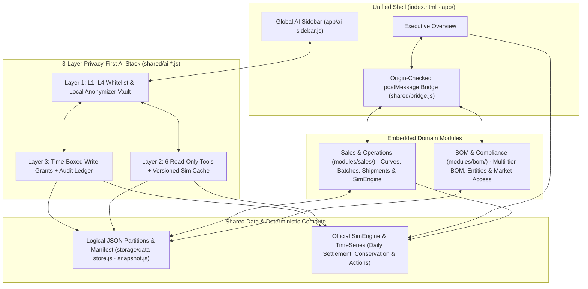

# Supply Chain Workbench

> A zero-dependency, local-first supply chain engineering workbench unifying **upstream BOM & compliance traceability**, **downstream deterministic sales & inventory simulation**, and a **privacy-gated, tool-driven AI assistant** with controlled write-back and audit rollback.


<!-- Demo Video Placeholder: Replace with walkthrough GIF / video once synthetic dataset recording is ready -->
<!--
## Demo

-->

---

## Why This Project Exists

Most supply chain prototypes split structural compliance and operational forecasting into disconnected spreadsheets—or bolt an unguarded LLM directly onto raw enterprise JSON.

**Supply Chain Workbench** (~33K LOC of pure, zero-build JavaScript) takes a different engineering approach:

- **Zero-Dependency, Local-First Core**: No frameworks, no bundler, no npm install, and no external database. State is organized into logical JSON partitions (`bom/entities`, `sales/master`, and immutable `sales/YYYY-MM` monthly partitions) backed by a rebuildable `manifest.json` index—running natively in the browser today and designed for 1:1 file-system mapping in a future desktop wrapper.
- **Single Deterministic Source of Truth**: The executive overview, sales dashboard, logistics views, and AI tools all query the exact same `SC.SimEngine` and `SC.TimeSeries` computation kernel—eliminating calculation drift between UI and AI.
- **Strict Plan vs. Estimate vs. Confirmed Fact Separation**: Immutable baselines (`originalPlan`), rolling operational forecasts (`revisedEstimate`), and verified actual milestones (`Confirmed Facts`) are modeled separately so delays never erase original commitments and AI can never overwrite confirmed history.
- **Deny-by-Default AI Security Boundary**: Real company names, contacts, document numbers, and commercial costs never leave the browser unless explicitly scoped and authorized. Writes are disabled by default, require time-boxed user grants, run through pre-commit simulation, and emit local audit receipts with version-checked rollback.

---

## System Architecture



---

## Module 1: BOM & Compliance (`modules/bom/`)

*Models upstream product structure, legal entities, plant-level supply paths, compliance exposure, and human-accountable market access.*

### Key Engineering Capabilities
- **Three-Layer Decoupled Data Model**:
  1. **Global Legal Entities (`Companies`)**: Canonical company directory with normalized global deduplication (case, width, and whitespace folding) and lossless duplicate-archive merging (`mergedCompanyArchives`).
  2. **Component-Level References**: Each BOM node independently references companies; reusing a component definition never silently leaks supplier bindings from another branch.
  3. **Edge-Scoped Supply Relationships & Plant Routes**: Supply links and plant-to-plant paths live strictly on specific parent-child BOM edges rather than being inferred globally.
- **Dual-Orientation BOM Canvas & Downstream Blast-Radius Tracing**:
  - Toggle seamlessly between **Horizontal** and **Vertical** tree layouts without mutating topology or losing manual coordinates.
  - **Four-State Compliance Model**: Replaces opaque numeric risk scores with explicit statuses—**Severe** (Red), **Risk** (Yellow), **Qualified** (Green), and **Unverified** (Gray)—preserving legacy scores (`legacyScore`) during schema migration.
  - **One-Click Downstream Trace**: Select any upstream supplier to hide unrelated nodes, re-layout the affected supply chain hierarchically, and trace impact straight to finished-product assemblers (`ROOT`).
- **Human-Accountable Market Access Evaluation**:
  - Tracks per-`BOM × Final Assembler × Target Market` (CN, EU, US, UK, JP, KR, CA, AU, IN) evidence items and open verification tasks.
  - Automatically traverses upstream BOM supply edges to surface known red/yellow compliance anomalies without auto-deciding outcomes.
  - Enforces strict governance invariants: assessments cannot be marked *Verified* while open verification items remain or without logged evidence.

---

## Module 2: Sales & Operations (`modules/sales/`)

*Runs a single authoritative business plan on a real calendar timeline—connecting factory output curves, production batches, cross-border shipments, customs clearance, and market fulfillment.*

### Key Engineering Capabilities
- **Functional Production Curves & Batch Allocation**:
  - Interactive calendar-axis curve editor supporting smooth point manipulation, mixed **rate mode** and **interval-total mode**, and calendar-date CSV import.
  - Drag-select any date window on a factory's curve to generate a production batch; factory nodes explicitly link to BOM final-assembly plants via read-only `bomFactoryId` extraction (`shared/bom-factories.js`) so upstream component plants never pollute finished-goods planning.
- **Milestone Logistics & Plan / Estimate / Fact Separation**:
  - Models every shipment through four milestones: **Depart → Border Arrival → Customs Release → Putaway**, enforcing a **D+1 next-day sellable** rule (optional transit ports are logged as events without fabricating intermediate warehouse inventory).
  - Separates immutable `originalPlan`, rolling `revisedEstimate`, and authoritative `Confirmed Facts` (dispatch, arrival, release, putaway, batch completion, and physical stocktakes). Confirmed downstream facts dynamically re-anchor next-milestone overdue detection without overwriting original planned dates.
- **Deterministic Daily Settlement Engine (`SC.SimEngine`)**:
  - Executes a strict intra-day conservation pipeline:
    1. Convert prior-day putaway (`D+1`) into sellable stock and release completed production batches.
    2. Validate and dispatch scheduled shipments (flagging `blocked` vs. `dispatch_unconfirmed` vs. confirmed `in_transit`).
    3. Fulfill daily market demand and compute exact shortage windows (`firstGapDate`, `totalDemandGap`).
    4. Reconcile physical stocktakes against anchor opening balances (`inventoryAnchorDate`).
  - Produces mutually exclusive point-in-time inventory buckets (`Available`, `In Transit`, `Awaiting Customs/Putaway`, `Shelved Pending Next-Day`, `Projected In-Pipeline`, `Unreleased Production`) consumed identically by the Sales views, Shell Overview, and AI tools.

---

## Module 3: Privacy-First AI Assistant (`shared/ai-*.js` & `app/ai-sidebar.js`)

*A three-layer, model-agnostic AI runtime engineered for enterprise data sensitivity, deterministic tool execution, and auditable mutations.*

### Layer 1: Deny-by-Default Privacy & Anonymization Gateway
- **Four-Tier Field Classification (`ai-privacy-schema.js`)**:
  - **L1 Structural**: Anonymized IDs, graph topology, compliance enums, milestone dates, BOM recipe ratios.
  - **L2 Identity**: Company/plant/market/product names, SKUs, cities, carriers, ports (hidden by default; disclosed only under explicit scopes or single-entity grants).
  - **L3 Commercial**: Quantities, inventory, demand, costs, legacy internal scores (disclosed strictly per analytical scope).
  - **L4 Sensitive & Free-Text**: Contacts, street addresses, bill-of-lading/container/tracking numbers, free-text notes, and custom `extraFields` (hard-blocked or dropped by default; free-text requires inspection + confirmation).
- **Local Deterministic Anonymizer Vault (`ai-anonymizer.js`)**:
  - Replaces both entity names *and* raw IDs with opaque sequential aliases (`COMP_001`, `FAC_001`, `SFAC_001`, `MKT_001`, `BAT_001`, `SHP_001`, `EVT_001`).
  - Preserves cross-module `FAC_xxx ↔ SFAC_xxx` joins via `manifest.json` without leaking raw identifiers.
  - Stored strictly in closure-private memory (`vault.toJSON()` is blocked; `detectVaultLeak()` guards outbound contexts and logs) and rehydrates aliases back to real names locally in the UI.
- **Dual Outbound Channel Isolation**: `model_context` and `web_search` enforce completely separate policy gates; external search never inherits model scopes or real-name grants and hard-blocks internal aliases or commercial figures.

### Layer 2: Provider-Agnostic Tool Runtime & Local Compute
- **6 Strictly Read-Only Whitelisted Tools (`ai-tool-registry.js`, `ai-tool-handlers.js`, `ai-tools.js`)**:

| Tool | Domain | Responsibility |
| :--- | :--- | :--- |
| `query_bom` | BOM | Paginated query of companies, plants, materials, and BOMs with pre-pagination global counts |
| `get_bom_detail` | BOM | Drill-down into a company, plant, or BOM graph (accepts raw IDs or opaque aliases like `COMP_002`) |
| `trace_supply_chain` | Cross-Module | `upstream`, `downstream`, `shared_upstream` (single-point-of-failure discovery), and `cross_module` plant-to-shipment tracing |
| `query_sales` | Sales | Partition-pruned queries across batches, shipments, confirmed facts, lanes, and curve integrals (`originMonth` indexed) |
| `query_world_state` | Simulation | Invokes official `SC.SimEngine` at any `asOfDate` & `horizonDays` for KPIs, stockout risk, and overdue alerts |
| `calculate` | Math / Dates | Declarative whitelisted aggregations (`sum`, `avg`, `weighted_avg`, `group_aggregate`, `days_of_cover`, `date_diff`, `date_add`)—zero `eval` |

- **Engineering Controls**: JSON-Schema argument validation, version-aware simulation cache (keyed by workspace revision + FNV-1a structural digest + `asOfDate` + `horizonDays`), strict payload/token budgets, and automatic schema export/call normalization for **OpenAI**, **Gemini**, and **Anthropic** formats.

### Layer 3: Controlled Write-Back, Intent Gating & Audit Rollback
- **Read-Only by Default**: External models have zero write tools unless the user opens a workspace-bound, **time-boxed write grant** (15 / 30 / 60 minutes) for specific operations.
- **Explicit Write-Intent Guard (`ai-client.js`)**: Analytical or hypothetical questions (*"What if this shipment is delayed 5 days?"*) are intercepted and blocked from triggering writes even while a temporary grant is active.
- **Whitelisted Mutations & Hard Blocks (`ai-mutations.js`)**:
  - Permitted only when granted: `shipment.adjust_eta`, `shipment.update_schedule`, `bom.update_compliance`.
  - Unconditionally blocked: record deletions/cancellations, multi-record bulk edits, ambiguous targets, optimistic concurrency conflicts (`VERSION_CONFLICT`), and any modification of confirmed actual facts (`*ActualDate` / `event.record`).
- **Simulate-Before-Commit & Safe Undo (`ai-audit.js`)**:
  - Every shipment ETA change locks `originalPlan`, runs `SC.Actions.simulateActions` to surface downstream stockout impact before committing via `SC.Actions.applyActions`, and writes a system-generated receipt to an isolated store (`sc-ai-audit-v1`, tagged `localOnly / neverSendToExternalModel`).
  - Clearing chat history (`sc-ai-chat-v1`) never deletes audit receipts. One-click **Safe Undo** verifies workspace revision and ensures no newer confirmed facts occurred before restoring the prior plan and logging a linked rollback receipt.
- **BYOK Credential Hygiene**: API keys live exclusively in `sessionStorage` and closure memory—never written to `localStorage`, backups, prompts, or audit logs, scrubbed from all error messages, and wiped automatically when the tab closes.

---

## How the Three Modules Work Together

Consider a single end-to-end operational scenario:

1. **BOM & Compliance** defines a multi-tier product BOM, flags an upstream chip supplier as `Risk`, and designates the finished-goods assembly plant (`FAC_001`).
2. **Sales & Operations** links to that assembly plant via `bomFactoryId`, generates a production batch from its output curve, dispatches a cross-border shipment (`SHP_001`), and tracks its customs and D+1 putaway timeline against target market demand.
3. **AI Assistant** receives a user prompt while viewing `SHP_001` (*"This shipment is running 5 days late—check the shortage impact and update the ETA"*):
   - Anonymizes all entities locally and calls `query_world_state` + `trace_supply_chain(cross_module)` via official engines.
   - Pre-simulates the 5-day shift via `SC.Actions.simulateActions` to quantify exact market stockout acceleration.
   - Under an active temporary write grant, updates `revisedEstimate` while preserving `originalPlan` and confirmed departure facts, refreshes both Sales and Shell Overview, rehydrates real names locally, and records a rollback-capable audit receipt.

---

## Quick Start

### 1. Run Locally (Zero Install)

Serve the repository over a local static HTTP server so all modules share the same browser origin (`localStorage`):

```bash
git clone https://github.com/antu939/supply-chain-app.git
cd supply-chain-app
python3 -m http.server 8765
```

Open `http://127.0.0.1:8765/` in any modern browser.

### 2. Configure the AI Assistant (Optional)

1. Click **AI Assistant** in the top-right shell bar, then open **Settings**.
2. Provide any OpenAI-compatible **API Base URL**, **Model ID**, and **API Key** (kept strictly in tab-scoped `sessionStorage`).
3. Tune reasoning effort (`low` / `medium` / `high` / `none`), output token cap, max tool calls per turn, and streaming mode (auto-falls back to non-streaming JSON if needed).

> **Note on Browser CORS**: To avoid routing API keys through untrusted third-party proxies, requests go directly to the configured endpoint. If a provider blocks browser CORS, run behind a trusted local reverse proxy or desktop wrapper (Electron/Tauri).

---

## Repository Layout

```text
supply-chain-app/
├── index.html                   # Unified application shell entry point
├── app/
│   ├── app.js / app.css         # Shell router, executive overview, iframe lifecycle
│   └── ai-sidebar.js / .css     # Global AI sidebar, grant controls, receipt cards
├── modules/
│   ├── bom/                     # BOM canvas, entity directory, compliance & market access
│   └── sales/                   # Curve editor, batches, shipments, SimEngine & WorldModel
├── storage/
│   ├── data-store.js            # Logical JSON partitions (bom/entities, sales/YYYY-MM) & manifest
│   └── snapshot.js              # Unified cross-module read snapshot for Shell Overview
├── shared/
│   ├── bridge.js                # Origin-checked iframe <-> shell postMessage protocol
│   ├── bom-factories.js         # Read-only extraction of BOM final-assembly plants
│   ├── ai-query.js              # Partition-pruned read-only query facade
│   ├── ai-privacy*.js           # L1–L4 schema, anonymizer vault, dual-channel gateway
│   ├── ai-tool-*.js / ai-tools.js  # Tool registry, 6 read-only handlers, cached executor
│   ├── ai-mutations.js          # Time-boxed write authorization, simulation & rollback
│   ├── ai-audit.js              # Isolated local-only audit receipt store
│   └── ai-client.js             # Multi-round tool loop, write-intent guard, SSE parser
├── tests/                       # 15 cross-module, simulation, privacy & AI regression suites
└── docs/                        # Detailed engineering specifications & audit reports
```

---

## Verification & Automated Tests

The repository includes **17 standalone Node.js regression test suites** (plus an in-browser runner at `modules/sales/tests/test-runner.html`) with **zero npm dependencies**, covering BOM integrity, Sales simulation conservation, confirmed-fact precedence, storage/bridge consistency, L1–L4 privacy leak prevention, tool execution, and AI write-back/rollback governance.

Run the entire suite from the repository root (Node.js required):

```bash
set -e
for file in tests/*.js modules/sales/tests/engine.test.js modules/bom/tests/regression.js; do
  echo "Running $file..."
  node "$file"
done
```

---

## Technical Documentation

Detailed architectural specs and verification reports are maintained in `docs/` (written in Chinese):

- [JSON Partitioning & Read-Only AI Query Layer](docs/data-and-ai-query.md)
- [AI Privacy & Anonymization Layer (Stage 1)](docs/AI_PRIVACY.md)
- [AI Tool Interface & Local Compute Layer (Stage 2)](docs/AI_TOOLS.md)
- [AI Integration, Authorized Writes & Audit Receipts (Stage 3)](docs/AI_INTEGRATION.md)
- [Sales Daily Simulation & Conservation Verification](docs/SALES_SIMULATION_STAGE3.md)
- [Consistency & Bugfix Reports](docs/CONSISTENCY_FIX_REPORT.md)

